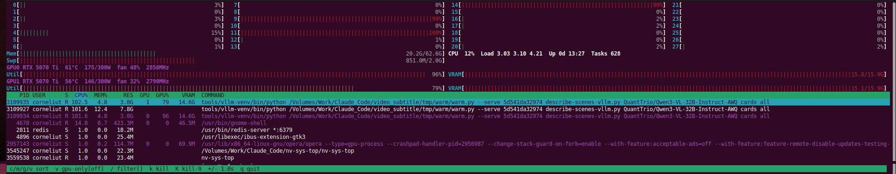

# nv-sys-top

An htop-style terminal monitor that shows your CPUs, memory **and NVIDIA GPUs**
in one screen, with a single process list that has CPU, RAM, GPU load and VRAM
side by side.



*28 CPU cores and two RTX 5070 Ti. A vision model is split across both cards:
each worker shows its own GPU, its own GPU load and 14.6 GB of VRAM, in the
same list as everything else on the machine.*

- One native binary written in C, about 40 KB. It needs ncurses and libc,
  nothing else.
- CPU, memory and processes are read straight from `/proc`.
- GPU data comes from **NVML** (`libnvidia-ml.so.1`, part of the NVIDIA
  driver). It is loaded at run time, so you don't need the CUDA toolkit to
  build. Without an NVIDIA driver the program still runs and shows the system
  part only.
- Every GPU is shown, plus each process's VRAM and its own SM load (`GPU%`).
- It doesn't call `nvidia-smi`, Python or any other helper.

## Build

Linux only. You need a C compiler, `make` and the ncurses development
package:

| Distro | Packages |
|---|---|
| Debian / Ubuntu | `sudo apt install build-essential libncurses-dev pkg-config` |
| Fedora / RHEL | `sudo dnf install gcc make ncurses-devel pkgconf` |
| Arch | `sudo pacman -S base-devel ncurses` |

```sh
git clone https://github.com/WebcasterLTD/nv-sys-top.git
cd nv-sys-top
make
./nv-sys-top
```

Install it system-wide (the default prefix is `/usr/local`):

```sh
sudo make install
```

Or for your user only:

```sh
make install PREFIX=$HOME/.local
```

## Usage

```
nv-sys-top [-d SECONDS] [-g] [-s cpu|mem|vram|gpu] [-b [-n ROWS]]

  -d SECONDS   refresh interval (default 1.0, 0.5 .. 10)
  -g           GPU processes only
  -s KEY       sort by cpu, mem, vram or gpu
  -b           batch: print one snapshot as text and exit
  -n ROWS      process rows in batch mode (default 20, 0 = all)
```

Batch mode is useful in scripts and logs:

```sh
nv-sys-top -b -g -s vram -n 0
```

### Keys

| Key | Action |
|---|---|
| `c` `m` `g` `u` | sort by CPU, RAM, VRAM, GPU load |
| `v` | show GPU processes only |
| `/` | filter by command line (empty input clears it) |
| arrows, PgUp, PgDn, Home, End | move the cursor |
| `k` / `K` | send SIGTERM / SIGKILL to the selected process (asks first) |
| `+` / `-` | slower / faster refresh |
| `q`, Esc, Ctrl-C | quit |

The cursor stays at the top of the list until you move it. After that it
follows the selected process as the order changes. Home pins it to the top
again.

## Notes

- Memory "used" is `MemTotal - MemAvailable`, the memory that can't be
  reclaimed without swapping.
- `CPU%` is per process across all of its threads, so 100% means one full
  core, as in htop.
- `VRAM` is the memory NVML reports for the process. A process on several
  GPUs shows every GPU index and its total VRAM across them.
- Per-process `GPU%` needs a driver that supports
  `nvmlDeviceGetProcessUtilization` (GeForce cards from Maxwell onward do).
  Where it isn't supported the column stays at 0.
- Inside containers, NVML reports host PIDs. Run nv-sys-top on the host to
  match GPU processes to the process list.

## License

MIT, see [LICENSE](LICENSE).

## Author

**Corneliu Ticu**, managing partner, [Webcaster Ltd](https://github.com/WebcasterLTD)

[corneliu.ticu@gmail.com](mailto:corneliu.ticu@gmail.com)

Questions, ideas or interest in this project: write to me directly.
